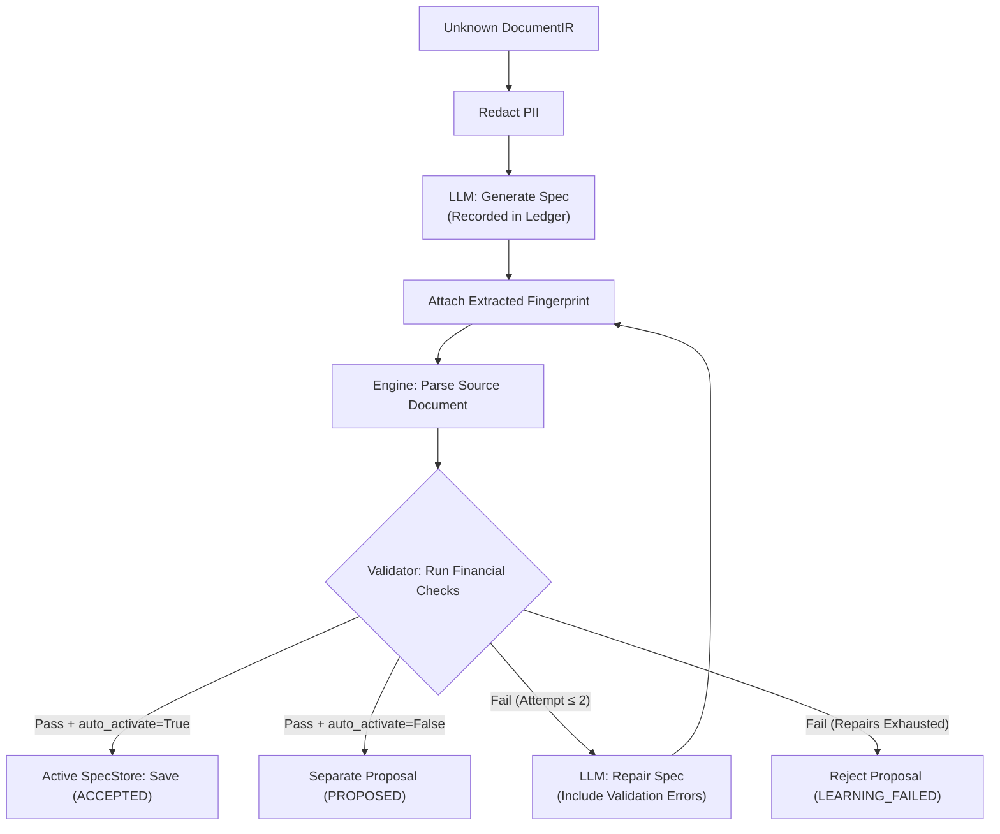
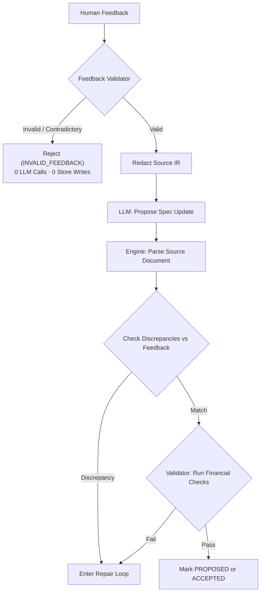

# Step 12: Learner (Build Step 11)

## What Was Implemented

Implemented the deterministic **Learner** module in `src/learner/` following Project Plan v4 and the Step 11 specification.

The Learner orchestrates generating, repairing, and refining deterministic parsing specifications (`ParsingSpec`) for unknown or mutated financial statements using:
1. PII sanitization via `src/redactor` so that personal identifiers are masked before prompt generation.
2. Provider-agnostic LLM completion and ledger auditing via `src/llm_adapter`.
3. In-memory execution against the source `DocumentIR` via `src/engine`.
4. Strict mathematical, reconciliation, and schema validation via `src/validator`.
5. Safe, versioned specification persistence via `src/specs/store.py` (`SpecStore`).
6. Comprehensive support for human review feedback (`HumanFeedback`) with multi-layer feedback validation and discrepancy checking.

---

## Architecture & Workflows

### 1. Unknown Document Learning Workflow



- **Candidate Spec Validation**: Every candidate specification generated by the LLM is immediately executed on the source `DocumentIR` using `ParsingEngine`, and the resulting `ParseResult` is validated by `Validator`.
- **Auto-Activation Control**: Brand-new unknown specifications auto-activate into `SpecStore` only when `auto_activate=True` and all validation checks pass with zero errors. Otherwise, specifications are marked `PROPOSED` and retained separately.
- **Repair Loop**: When a candidate specification fails schema parsing, extraction, or financial validation (e.g. cash reconciliation, portfolio weights), the failure reasons are structured and provided in a repair prompt back to the LLM. The learner allows up to 2 repair retries (3 total attempts). If all attempts fail, the proposal is rejected (`LEARNING_FAILED`) without modifying `SpecStore`.

### 2. Human Review Feedback Adaptation Workflow



- **Pre-Execution Validation**: Human review feedback is validated for safe format IDs, non-empty corrections, valid field whitelists, parseable decimals, non-negative quantities, and internal arithmetic consistency (e.g. `units × nav_per_unit ≈ closing_value`). Malformed feedback is rejected immediately with zero LLM calls.
- **Correction Discrepancy Guard**: After parsing with the proposed spec, extracted metadata, summary fields, and table counts are compared directly against the reviewer's corrections. Any mismatch is flagged as an error and sent to the repair loop.
- **Preservation of Active Specifications**: Existing active specifications in `SpecStore` are never modified or overwritten if a proposal fails or is rejected. Non-activated proposals can be stored separately using `draft_` prefixes or inspected as in-memory proposals.

---

## Modules Created

### `src/learner/models.py`

Pydantic data models and enums:

| Model | Purpose |
|---|---|
| `ProposalStatus` | Enum: `ACCEPTED` (activated), `PROPOSED` (draft proposal), `REJECTED` (repairs exhausted), `INVALID_FEEDBACK` (malformed feedback). |
| `HumanFeedback` | Container for reviewer corrections: `format_id`, `corrected_metadata`, `corrected_summary`, `corrected_holdings`, `corrected_transactions`, `notes`. |
| `LearnerConfig` | Configuration: `max_repairs` (default 2), `auto_activate` (default `False`), `temperature` (default 0.0), `model`, `draft_prefix`. |
| `LearningAttempt` | Detailed log of an individual attempt: attempt number, raw LLM response, candidate spec, parse result, validation findings, success status. |
| `LearningResult` | Top-level outcome: `format_id`, `status`, `document_status`, `spec`, `is_active`, `attempts_count`, `parse_result`, `validation_result`, `repair_history`. |

### `src/learner/feedback_validator.py`

Dedicated validation routines for human corrections:
- Format ID validation: rejects path traversal, directory escapes, or unsafe characters.
- Non-empty check: ensures feedback contains actionable corrections.
- Whitelist checking against domain models: `Summary`, `Holding`, `Transaction`.
- Data type and decimal conversion verification.
- Non-negativity constraints for units, NAV, quantities, and weights.
- Internal arithmetic reconciliation checks.

### `src/learner/prompts.py`

Structured prompt construction with PII protection:
- `prepare_redacted_doc_context()`: Runs `Redactor` on document text and compiles table structural outlines.
- `build_initial_prompt()`: Standardized prompt for learning unknown templates.
- `build_repair_prompt()`: Context-rich repair prompt detailing previous spec and validation errors.
- `build_feedback_prompt()`: Reviewer-correction-driven prompt combining human corrections, existing spec, and redacted layout.

### `src/learner/learner.py`

Core orchestrator class:
- `learn()`: Automated learning loop for unknown documents.
- `learn_from_feedback()`: Refinement workflow incorporating human feedback.
- `propose_spec()`: Explicit draft proposal method guaranteeing no overwrite of active specs.
- `save_draft_proposal()`: Persists draft proposals under separate `draft_<format_id>.json` files.
- `_verify_declared_locators()`: Learner-specific guard verifying that all proposed locators (summary fields, metadata fields, holdings tables) resolve to actual values in the training document. Prevents accepting candidate specs with hallucinated/unresolved anchors.
- `_execute_learning_loop()`: Unified deterministic loop handling attempts, repair prompts, engine runs, locator verification, and validation.

### `src/learner/__init__.py`

Public package exports for `Learner`, `LearnerConfig`, `HumanFeedback`, `ProposalStatus`, `LearningResult`, `LearningAttempt`, and `validate_feedback`.

---

## Tests Created

**`tests/test_learner.py`** — 14 test cases across 6 test classes:

| Class | Tests | What it covers |
|---|---|---|
| `TestFeedbackValidation` | 8 | Empty feedback rejection, path traversal rejection, unknown summary fields, unparseable decimals, negative units, contradictory units×NAV arithmetic, unknown holding fields, invalid transaction types, valid feedback approval. |
| `TestSuccessfulLearning` | 2 | Unknown document learning without auto-activation (`PROPOSED`, active store untouched), learning with auto-activation (`ACCEPTED`, active store updated). |
| `TestLearnerRepairLoop` | 2 | Recovery from initial validation failure via repair prompt; retries exhausted producing `REJECTED` and `LEARNING_FAILED` after 3 total attempts. |
| `TestLearningFromHumanFeedback` | 3 | Successful feedback learning; invalid feedback rejection with 0 LLM calls; reviewer correction discrepancy rejection. |
| `TestPreservationOfExistingSpecifications` | 2 | Active specification byte-for-byte preservation on rejected proposal; draft proposal kept strictly separate from active format. |
| `TestPIIRedactionInPrompts` | 1 | Verification that raw PAN and investor names in source text are redacted to `[REDACTED_PAN]` and `[REDACTED_NAME]` in LLM prompts. |

---

## Files Created / Modified

| File | Status | Role |
|---|---|---|
| `src/learner/__init__.py` | Created | Public package exports |
| `src/learner/models.py` | Created | Proposal status, feedback, and result models |
| `src/learner/feedback_validator.py` | Created | Human review feedback validation routines |
| `src/learner/prompts.py` | Created | PII-redacted prompt generation and repair templates |
| `src/learner/learner.py` | Created | `Learner` class and learning loop orchestration |
| `tests/test_learner.py` | Created | Unit test suite |
| `docs/ai_log/step-12.md` | Created | Implementation log and design documentation |

---

## Known Limitations

1. **LLM Context Window Limits**:
   Very large statements (e.g. 50+ pages of transactions) will require layout truncations or page-range selection before prompt construction to avoid exceeding LLM context limits.
2. **Ambiguous Column Headers**:
   If a table has non-standard abbreviations (e.g. `Scrip`, `Sec. Descr.`), the LLM may need human feedback to map them accurately to canonical holding fields.
3. **Multi-Template Drift**:
   When drift occurs across multiple pages simultaneously, human review with `propose_spec()` remains recommended over immediate automated activation.

---

## Terminal Commands to Verify

```bash
# Run the learner unit tests
PYTHONPATH=. ./.venv/bin/pytest tests/test_learner.py -v

# Run with concise tracebacks
PYTHONPATH=. ./.venv/bin/pytest tests/test_learner.py -v --tb=short

# Run full project test suite excluding legacy fingerprint test
PYTHONPATH=. ./.venv/bin/pytest tests/ -v --ignore=tests/test_fingerprint.py
```
