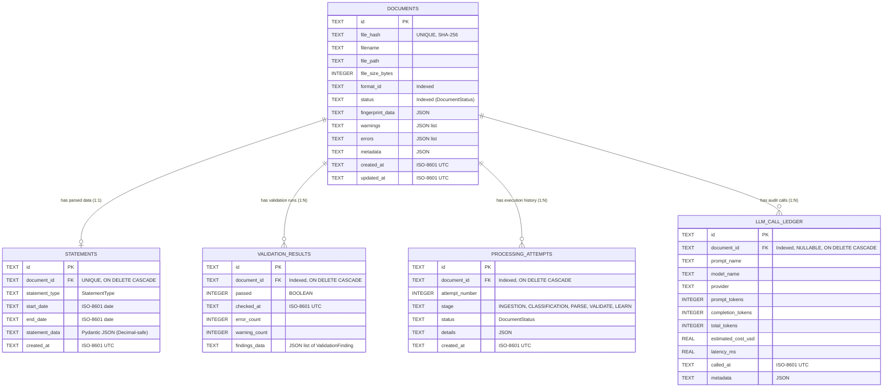

# Step 13: Store (Build Step 12)

## What Was Implemented

Implemented the persistent SQLite storage layer in `src/store/` following Project Plan v4 (Store).
The module provides robust, ACID-compliant persistence for document processing records, parsed financial statements, validation outcomes, LLM call audit records, and multi-attempt processing history.

The storage layer is independent of document parsing logic, LLM adapter providers, and ingestion pipeline orchestration. It communicates strictly via domain models (`Statement`, `ParseResult`, `ValidationResult`, `FormatFingerprint`, `LLMCallRecord`) and parameterized SQL queries.

---

## Architecture & Database Schema

The SQLite schema is initialized automatically upon store creation and enforces foreign key integrity via `PRAGMA foreign_keys = ON;` and concurrent read efficiency via `PRAGMA journal_mode = WAL;`.



### Table Definitions & Justifications

1. **`documents`**:
   - Primary entity for every ingested PDF or digital report.
   - `file_hash`: SHA-256 digest of original file bytes. Unique constraint prevents duplicate processing by default.
   - `status`: Indexed to support fast queue queries (e.g., finding all `PARSED`, `FAILED`, or `NEEDS_REVIEW` documents).
   - `format_id`: Indexed to aggregate parsed volume per PMS provider/format.
   - `fingerprint_data`: Stores serialized `FormatFingerprint` including layout stats and anchors.

2. **`statements`**:
   - 1-to-1 relationship with `documents`.
   - `statement_data`: Serialized using Pydantic's `Statement.model_dump_json()`. SQLite lacks a native Decimal data type; serializing via Pydantic preserves exact Decimal precision (e.g. `"1000000.50"`) without floating-point representation drift.
   - `start_date`, `end_date`, `statement_type`: Extracted into top-level queryable columns.

3. **`validation_results`**:
   - 1-to-many relationship with `documents`. Stores validation audit history per document.
   - `findings_data`: Stores structured list of `ValidationFinding` items (severity, check type, message, difference, field path).

4. **`processing_attempts`**:
   - Tracks iterative execution attempts (e.g., initial parsing, human review feedback, learner re-parse attempts).
   - Indexed on `(document_id, attempt_number)`.

5. **`llm_call_ledger`**:
   - Persistent store for LLM usage tracking across Learner runs.
   - Provides per-document or global token usage, latency, and cost aggregation (`get_llm_usage_summary`).

---

## Modules Created

### `src/store/exceptions.py`
- `StoreError`: Base exception for storage failures.
- `DocumentNotFoundError`: Raised when querying a non-existent document ID or file hash.
- `DuplicateDocumentError`: Raised when registering a file hash that already exists when duplicates are disabled.
- `StatementNotFoundError`: Raised when querying a statement for a document that has not yet been parsed.
- `DatabaseSchemaError`: Raised on initialization DDL failures.

### `src/store/models.py`
Pydantic models representing database entity records:
- `DocumentRecord`: Complete document state, format metadata, timestamps, errors, warnings.
- `StatementRecord`: Container for parsed `Statement`, date bounds, and creation timestamp.
- `ValidationRecord`: Validation summary containing `ValidationResult` and findings.
- `ProcessingAttemptRecord`: Audit step entry for pipeline attempts.

### `src/store/schema.py`
- Complete DDL strings with `CREATE TABLE IF NOT EXISTS`, `ON DELETE CASCADE` foreign keys, and indexes:
  - `idx_documents_file_hash` (UNIQUE)
  - `idx_documents_status`
  - `idx_documents_format_id`
  - `idx_statements_doc_id`
  - `idx_validation_doc_id`
  - `idx_attempts_doc_id`
  - `idx_llm_ledger_doc_id`
- `initialize_schema(conn)`: Executes table definitions and index creation within an isolated transaction.

### `src/store/store.py`
- `StatementStore`: Primary persistence engine with context-managed transactions (`_get_connection`), automatic rollback on failure, WAL journaling, and support for both persistent disk databases and `:memory:` databases.
- Operations implemented:
  - **Document CRUD**: `create_document()`, `get_document()`, `get_document_by_hash()`, `update_document_status()`, `update_document_format()`, `list_documents()` (with status/format filters and limit/offset pagination), `delete_document()`.
  - **Statement Persistence**: `save_statement()`, `get_statement()`, `get_statement_model()`, `save_parse_result()` (atomic transaction updating document status, errors, warnings, and statement row in one commit).
  - **JSON Export**: `export_statement_json()` writes matching JSON representations of parsed statements for external systems.
  - **Validation Persistence**: `save_validation_result()`, `get_latest_validation_result()`, `list_validation_results()`.
  - **LLM Call Ledger**: `record_llm_call()`, `list_llm_calls()`, `get_llm_usage_summary()`.
  - **Processing Attempts**: `record_processing_attempt()`, `list_processing_attempts()`.

### `src/store/__init__.py`
Exposes the public store interface: `StatementStore`, models, and exceptions.

---

## Key Design Decisions

1. **Decimal Preservation**:
   Financial data in `Statement` contains `Decimal` fields (`PortfolioValue`, `Quantity`, `Price`, `CashBalance`). Rather than storing individual SQL columns for nested financial models, the store preserves the complete Pydantic model serialized as JSON (`Statement.model_dump_json()`), and reconstructs it with `Statement.model_validate_json()`. This guarantees lossless round-tripping.
2. **Atomic Transitions**:
   `save_parse_result()` commits both the document metadata update (status set to `PARSED` or `FAILED`, warnings, errors) and the statement JSON inside a single database transaction. If any part fails, the entire transaction rolls back to ensure zero orphan statements or inconsistent document states.
3. **In-Memory Connection Longevity**:
   When initialized with `db_path=":memory:"`, SQLite creates a fresh, separate database on every `connect()` call. `StatementStore` retains an internal persistent connection `_mem_conn` when `:memory:` is specified, allowing unit tests to execute multi-step workflows against an in-memory database without losing schema or data.
4. **Separate SpecStore vs StatementStore**:
   As specified in the project plan, parsing specifications (`ParsingSpec`) are managed by `src/specs/store.py` (`SpecStore`). The `StatementStore` exclusively manages documents, statements, validation records, attempts, and LLM call audits.

---

## Tests Created

**`tests/test_store.py`** — 19 tests across 7 test classes:

| Class | Tests | What it covers |
|---|---|---|
| `TestDatabaseInitialization` | 2 | Schema creation on disk and `:memory:`, idempotency of `initialize_schema()`. |
| `TestDocumentOperations` | 6 | Document creation, retrieval by ID & hash, missing document raises `DocumentNotFoundError`, duplicate detection raises `DuplicateDocumentError`, status & format updates, pagination & filtering, deletion with cascade. |
| `TestStatementPersistenceAndExport` | 4 | Statement persistence, lossless Decimal round-tripping, missing statement raises `StatementNotFoundError`, atomic `save_parse_result`, JSON file export matching DB. |
| `TestValidationResultPersistence` | 2 | ValidationResult persistence with structured findings, latest validation retrieval. |
| `TestLLMCallLedgerPersistence` | 2 | Recording LLM call records with token and cost attribution, ledger cost/token aggregation. |
| `TestProcessingAttemptHistory` | 2 | Recording multi-attempt history across pipeline stages, ordering preservation. |
| `TestTransactionRollback` | 1 | Verification that database failures roll back modifications without partial state corruption. |

---

## Files Created / Modified

| File | Status | Description |
|---|---|---|
| `src/store/__init__.py` | Created | Package exports |
| `src/store/exceptions.py` | Created | Exception hierarchy (`StoreError`, `DocumentNotFoundError`, etc.) |
| `src/store/models.py` | Created | Record models for Document, Statement, Validation, and Attempt |
| `src/store/schema.py` | Created | Schema DDL, table constraints, indexes, and initialization |
| `src/store/store.py` | Created | `StatementStore` implementation with ACID operations and JSON export |
| `tests/test_store.py` | Created | Comprehensive unit test suite (19 test cases) |
| `docs/ai_log/step-13.md` | Created | Implementation log and architectural documentation |

---

## Known Limitations

1. **Local SQLite Concurrency**:
   SQLite is optimized for single-process local usage with WAL mode. For distributed multi-worker environments, a shared Postgres instance would be preferable if concurrent ingestion scale exceeds local disk throughput.
2. **Statement Level SQL Filtering**:
   Because `Statement` details (holdings, transactions, cash flows) are stored as structured JSON, SQL queries cannot directly filter by individual holding ISIN without using SQLite's JSON extensions (`json_extract`). Full-text search or specialized tabular indexing on individual holdings can be added in future iterations if required.

---

## Terminal Commands to Verify

```bash
# Run the store unit tests
PYTHONPATH=. ./.venv/bin/pytest tests/test_store.py -v

# Run with concise tracebacks
PYTHONPATH=. ./.venv/bin/pytest tests/test_store.py -v --tb=short

# Run full project test suite excluding legacy fingerprint test
PYTHONPATH=. ./.venv/bin/pytest tests/ -v --ignore=tests/test_fingerprint.py
```
