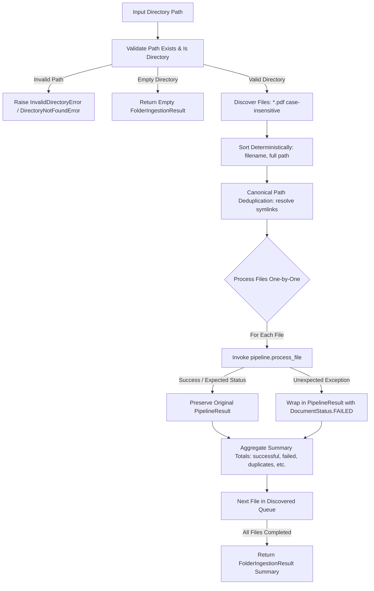
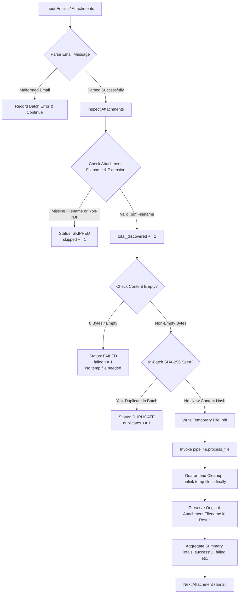

# Step 15: Ingestion Modules (Folder & Email Ingestion)

This document covers the implementation of the ingestion subsystem in `src/ingestion/`:
1. **Folder Ingestion**: Deterministic scanning and processing of statement PDFs in directory trees.
2. **Email Ingestion**: Extraction, safe staging, and processing of statement PDF attachments from email messages.

---

# Part 1: Folder Ingestion

## 1. The Problem This Module Solves

Real-world PMS/AIF document processing requires:
1. **Directory Scanning**: Ingesting all statement PDF files contained within a directory without requiring callers to manually discover and curate paths.
2. **Deterministic Processing**: Guaranteeing consistent, reproducible file ordering (alphabetical by filename) regardless of underlying filesystem or OS-dependent directory listing semantics.
3. **Failure Isolation**: Ensuring that one corrupt, unreadable, or encrypted PDF does not crash the entire ingestion job or prevent the remaining files from being processed.
4. **Transparent Deduplication**: Avoiding processing the same file multiple times when encountered via filesystem symlinks or duplicate references within a single ingestion run.
5. **Comprehensive Batch Reporting**: Aggregating batch metrics (discovered, processed, successful, failed, skipped, duplicates, quarantined) directly from the existing `PipelineResult` lifecycle states, without inventing artificial statuses.

The **Folder Ingestion** module (`src/ingestion/folder.py`) bridges filesystem directories and the existing `Pipeline` orchestrator with a clean, minimal, non-interactive interface.

---

## 2. Architecture & Pipeline Interaction



### Folder Ingestion Public API:
- `FolderIngester(pipeline: PipelineInterface, config: FolderIngestionConfig | None = None)`
  - `ingest(directory, recursive=None, password=None) -> FolderIngestionResult`
  - `process_directory(directory, recursive=None, password=None) -> FolderIngestionResult`
  - `discover_files(directory, recursive=None) -> list[Path]`
- `ingest_folder(directory, pipeline, recursive=False, config=None, password=None) -> FolderIngestionResult`
- `FolderIngestion = FolderIngester` (alias)
- `FolderIngestionSummary = FolderIngestionResult` (alias)

---

# Part 2: Email Ingestion

## 1. Purpose of Email Ingestion

Financial statements are frequently delivered as attachments in periodic client reporting emails. Ingestion requires:
1. **Attachment Discovery & Extraction**: Extracting eligible statement attachments from email containers (supporting standard library `email.message.EmailMessage`, `Message`, raw `.eml` files/bytes, and structured attachment objects).
2. **Safe PDF Filtering**: Filtering out non-PDF attachments (e.g. logos, disclaimers, `.txt`, `.png`, `.csv`) and email bodies safely without attempting statement parsing.
3. **Robust Input Handling**: Gracefully handling missing filenames, empty attachments (0 bytes), and malformed email messages without failing the batch.
4. **Reliable Temporary Staging**: Safely writing attachment binary payloads to temporary files for pipeline consumption, with guaranteed file cleanup even if the pipeline crashes.
5. **Deterministic Deduplication**: Detecting identical attachments within a batch via content hashing (SHA-256) and respecting the database deduplication capabilities of the `Pipeline`.
6. **Unified Batch Reporting**: Providing structured summaries (`EmailIngestionResult`) tracking emails, attachments, discovery, success, failure, duplicates, and quarantine states.

---

## 2. Architecture & Processing Flow



---

## 3. Email Ingestion Public API

### 3.1. Models (`src/ingestion/models.py`)

- **`EmailAttachment`**:
  ```python
  class EmailAttachment(BaseModel):
      filename: str | None = None
      content: bytes = b""
      content_type: str | None = None
  ```
- **`EmailMessageInput`** (alias: `EmailMessage`):
  ```python
  class EmailMessageInput(BaseModel):
      email_id: str | None = None
      sender: str | None = None
      subject: str | None = None
      attachments: list[EmailAttachment] = []
  ```
- **`EmailIngestionConfig`**:
  ```python
  class EmailIngestionConfig(BaseModel):
      supported_extensions: list[str] = [".pdf"]
      passwords: list[str] = []
      deduplicate_batch: bool = True
  ```
- **`EmailIngestionResult`** (alias: `EmailIngestionSummary`):
  - Fields: `total_emails`, `total_attachments`, `total_discovered`, `processed`, `successful`, `failed`, `duplicates`, `quarantined`, `skipped`, `results`, `errors`.
  - Properties: `discovered_attachments`, `discovered_files`, `total_processed`, `success_count`, `failure_count`, `skipped_count`.

---

### 3.2. Core Class & Functions (`src/ingestion/email.py`)

- **`EmailIngester`**:
  - `ingest_emails(emails: Sequence[Any], password: str | None = None) -> EmailIngestionResult`
  - `ingest_email(email: Any, password: str | None = None) -> EmailIngestionResult`
  - `ingest_attachments(attachments: Sequence[EmailAttachment | dict], password: str | None = None) -> EmailIngestionResult`
  - `ingest(source: Any, password: str | None = None) -> EmailIngestionResult`
- **Class Alias**: `EmailIngestion = EmailIngester`
- **Helper Functions**:
  - `ingest_emails(emails, pipeline, config=None, password=None) -> EmailIngestionResult`
  - `ingest_email_attachments(attachments, pipeline, config=None, password=None) -> EmailIngestionResult`
  - `parse_email_message(email_input) -> EmailMessageInput`

---

## 4. Usage Example

```python
from email.message import EmailMessage
from src.pipeline.pipeline import Pipeline
from src.ingestion import (
    EmailAttachment,
    EmailIngester,
    EmailMessageInput,
    ingest_email_attachments,
    ingest_emails,
)

pipeline = Pipeline()
ingester = EmailIngester(pipeline=pipeline)

# Approach 1: Directly supplying EmailAttachment objects
attachments = [
    EmailAttachment(filename="statement.pdf", content=b"%PDF-1.4 ..."),
    EmailAttachment(filename="notice.txt", content=b"Non-statement text"),
]
result = ingester.ingest_attachments(attachments)
print(f"Discovered: {result.total_discovered}, Successful: {result.successful}, Skipped: {result.skipped}")

# Approach 2: Using standard library EmailMessage
msg = EmailMessage()
msg["Subject"] = "Quarterly Valuation"
msg["From"] = "wealth@kotak.com"
msg.set_content("Please find attached your statement.")
msg.add_attachment(b"%PDF-1.4 ...", maintype="application", subtype="pdf", filename="kotak.pdf")

result_msg = ingester.ingest_email(msg)

# Approach 3: Convenience functional wrapper
result_batch = ingest_emails([msg], pipeline=pipeline)
```

---

## 5. Error Handling & Duplicate Detection

1. **Missing Filename or Non-PDFs**:
   - Filtered out safely prior to any pipeline invocation.
   - Counted under `result.skipped += 1`.
2. **Empty Attachments (0 bytes)**:
   - Evaluated without crashing or writing empty files to disk.
   - Recorded as `DocumentStatus.FAILED` with error `"Attachment content is empty"`, updating `failed += 1`.
3. **Invalid PDF Content**:
   - Written to safe temp file and dispatched to `Pipeline`.
   - Extraction failure is trapped and categorized as `DocumentStatus.FAILED`.
4. **Pipeline Exceptions**:
   - Isolated per-attachment using `try...except Exception as exc`.
   - Creates a structured `PipelineResult` with `DocumentStatus.FAILED` and records the error message.
   - Subsequent attachments and emails proceed unhindered.
5. **Temporary File Cleanup**:
   - Uses `try...finally` with `tempfile.NamedTemporaryFile` and explicit `unlink()`.
   - Guaranteed cleanup regardless of success, validation errors, or unexpected exceptions.
6. **In-Batch Duplicate Detection**:
   - Computes SHA-256 content hashes in memory for attachments in the current batch.
   - When a duplicate content hash is encountered, records `DocumentStatus.DUPLICATE` with `is_duplicate=True` without re-processing.
   - Cross-batch duplicates continue to be identified by the underlying `StatementStore` in the `Pipeline`.
7. **Privacy & Security**:
   - Does not log email bodies or raw attachment binary payloads.
   - Temporary files are deleted immediately after each attachment is processed.

---

## 6. Modules Created or Modified

- **Modified**:
  - `src/ingestion/models.py`: Added `EmailAttachment`, `EmailMessageInput`, `EmailMessage`, `EmailIngestionConfig`, `EmailIngestionResult`, `EmailIngestionSummary`.
  - `src/ingestion/exceptions.py`: Added `EmailIngestionError`, `MalformedEmailError`.
  - `src/ingestion/__init__.py`: Exported all email ingestion classes, models, and helper functions.
- **Created**:
  - `src/ingestion/email.py`: Core email parsing, attachment extraction, temporary file handling, and batch orchestration.
  - `tests/test_email_ingestion.py`: 15 focused unit tests covering valid attachments, multiple emails, filtering, empty/malformed inputs, error isolation, duplicates, temp-file cleanup, and stdlib `.eml` parsing.

---

## 7. Known Limitations

1. **No Live Inbox / IMAP Connection**:
   - Per requirements, this module processes already-retrieved email data (`EmailAttachment`, stdlib `EmailMessage`, raw `.eml` bytes or files). Real-time mailbox synchronization (e.g., IMAP, Gmail API, Microsoft Graph) is intentionally out of scope for this step.
2. **PDF Attachments Only**:
   - Only `.pdf` attachments are currently parsed. Other statement formats (e.g. `.xlsx`, `.csv`) are skipped by default.
3. **Sequential Attachment Processing**:
   - Processes attachments sequentially within each email.
