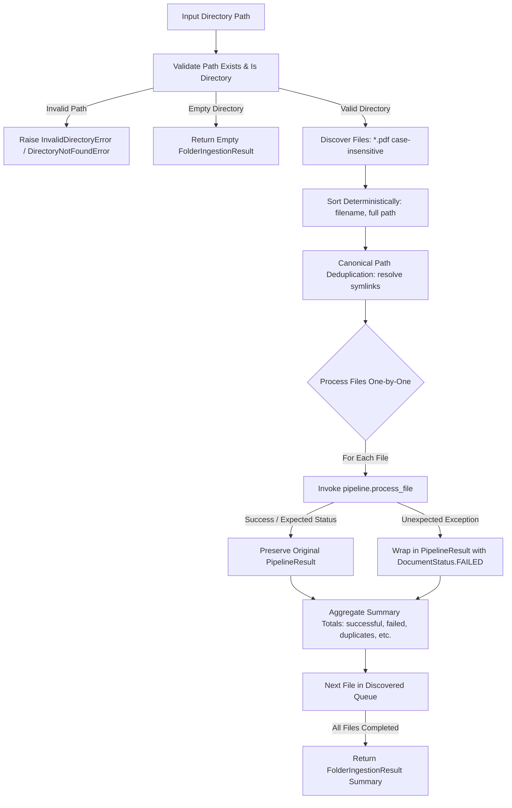

# Step 15: Folder Ingestion (Build Step 14)

## 1. The Problem This Module Solves

Up to Step 14, the PMS Parser project provided single-file and list-based batch processing directly via the `Pipeline` class. However, real-world document processing requires:
1. **Directory Scanning**: Ingesting all statement PDF files contained within a directory without requiring callers to manually discover and curate paths.
2. **Deterministic Processing**: Guaranteeing consistent, reproducible file ordering (alphabetical by filename) regardless of underlying filesystem or OS-dependent directory listing semantics.
3. **Failure Isolation**: Ensuring that one corrupt, unreadable, or encrypted PDF does not crash the entire ingestion job or prevent the remaining files from being processed.
4. **Transparent Deduplication**: Avoiding processing the same file multiple times when encountered via filesystem symlinks or duplicate references within a single ingestion run.
5. **Comprehensive Batch Reporting**: Aggregating batch metrics (discovered, processed, successful, failed, skipped, duplicates, quarantined) directly from the existing `PipelineResult` lifecycle states, without inventing artificial statuses.

The **Folder Ingestion** module (`src/ingestion/`) bridges filesystem directories and the existing `Pipeline` orchestrator with a clean, minimal, non-interactive interface.

---

## 2. Module Responsibilities & Pipeline Interaction



### Key Responsibilities:
- **Path Validation**: Verifies that the specified target path exists and is a directory. Reports invalid paths clearly via structured exceptions (`DirectoryNotFoundError`, `NotADirectoryPathError`, both inheriting from `InvalidDirectoryError`).
- **Deterministic File Discovery**: Scans for supported PDF extensions (`.pdf`, `.PDF`, `.Pdf`) and sorts them alphabetically by filename (`key=lambda p: (p.name, str(p))`).
- **Configurable Recursion**: Defaults to non-recursive discovery (`recursive=False`) while supporting explicit recursive subdirectory traversal when configured.
- **In-Batch Path Deduplication**: Resolves paths canonically to avoid processing identical physical files or symlinks multiple times within a single batch.
- **Pipeline Delegation**: Feeds files to `pipeline.process_file()` one by one without duplicating any parsing, classification, validation, or storage logic.
- **Fault Isolation**: Wraps per-file execution in an exception safety net; any unexpected error creates a structured `PipelineResult` with `DocumentStatus.FAILED`, preserving progress for all remaining documents.
- **Result Aggregation**: Aggregates batch totals (`successful`, `failed`, `skipped`, `duplicates`, `quarantined`) derived purely from the original `PipelineResult` and `DocumentStatus` models.

---

## 3. Public API & Result Structure

### 3.1. Public Classes and Functions (`src/ingestion/`)

#### `FolderIngester`
Main class orchestrating directory scanning and batch dispatching.
```python
class FolderIngester:
    def __init__(
        self,
        pipeline: PipelineInterface,
        config: FolderIngestionConfig | None = None,
    ) -> None: ...

    def discover_files(
        self,
        directory: str | Path,
        recursive: bool | None = None,
    ) -> list[Path]: ...

    def ingest(
        self,
        directory: str | Path,
        recursive: bool | None = None,
        password: str | None = None,
    ) -> FolderIngestionResult: ...

    # Alias for ingest()
    process_directory = ingest
```

#### `ingest_folder` (Convenience Functional Wrapper)
```python
def ingest_folder(
    directory: str | Path,
    pipeline: PipelineInterface,
    recursive: bool = False,
    config: FolderIngestionConfig | None = None,
    password: str | None = None,
) -> FolderIngestionResult: ...
```

#### `PipelineInterface` (Protocol)
Defines the minimal interface required from the Pipeline:
```python
@runtime_checkable
class PipelineInterface(Protocol):
    def process_file(
        self,
        file_path: str | Path,
        password: str | None = None,
    ) -> PipelineResult: ...
```

---

### 3.2. Configuration Model (`FolderIngestionConfig`)

```python
class FolderIngestionConfig(BaseModel):
    recursive: bool = False
    """Whether to search subdirectories recursively. Defaults to False."""

    file_extensions: list[str] = [".pdf"]
    """Supported file extensions to discover (case-insensitive). Defaults to ['.pdf']."""

    passwords: list[str] = []
    """Optional candidate passwords to pass for encrypted files."""
```

---

### 3.3. Result Summary Model (`FolderIngestionResult`)

```python
class FolderIngestionResult(BaseModel):
    directory: str
    total_discovered: int = 0
    processed: int = 0
    successful: int = 0
    failed: int = 0
    duplicates: int = 0
    quarantined: int = 0
    skipped: int = 0
    results: list[PipelineResult] = []
    errors: list[str] = []

    # Convenience aliases
    @property
    def discovered_files(self) -> int: ...
    @property
    def total_processed(self) -> int: ...
    @property
    def success_count(self) -> int: ...
    @property
    def failure_count(self) -> int: ...
    @property
    def skipped_count(self) -> int: ...

# Class alias:
FolderIngestionSummary = FolderIngestionResult
```

### Metric Categorization Rules (Aligned with `DocumentStatus`):
| Metric | Condition | Meaning |
| :--- | :--- | :--- |
| `duplicates` | `res.is_duplicate or res.status == DUPLICATE` | File content hash matched an existing ingested document. |
| `successful` | `res.status in (PARSED, PARSED_WITH_WARNINGS)` | Document parsed and reconciled cleanly or with minor non-fatal warnings. |
| `skipped` | `res.status == SKIPPED` | Non-statement file detected by classifier (e.g. notices, brochures). |
| `quarantined`| `res.is_quarantined` (`NEEDS_REVIEW`, `DRIFT_SUSPECTED`, `MAYBE`, `LEARNING_FAILED`) | Document placed in review quarantine for human inspection or learning. |
| `failed` | `res.status in (FAILED, NEEDS_PASSWORD)` or unexpected execution crash | Fatal extraction, encryption without password, or unhandled file error. |

---

## 4. Usage Example

```python
from pathlib import Path
from src.pipeline.pipeline import Pipeline
from src.ingestion import FolderIngester, FolderIngestionConfig, ingest_folder

# 1. Initialize existing pipeline
pipeline = Pipeline()

# 2. Option A: Ingest folder using FolderIngester
ingester = FolderIngester(
    pipeline=pipeline,
    config=FolderIngestionConfig(recursive=False),
)
summary = ingester.ingest(Path("./samples/monthly_statements"))

print(f"Discovered: {summary.total_discovered}")
print(f"Successful: {summary.successful}")
print(f"Duplicates: {summary.duplicates}")
print(f"Quarantined: {summary.quarantined}")
print(f"Failed: {summary.failed}")

# Access per-file PipelineResult objects
for file_result in summary.results:
    print(file_result.file_path, file_result.status, file_result.errors)

# 3. Option B: Ingest folder using functional shortcut
summary_rec = ingest_folder(
    directory="./samples",
    pipeline=pipeline,
    recursive=True,
)
```

---

## 5. Error Handling Behavior

1. **Non-Existent Directory**:
   - Raises `DirectoryNotFoundError` (which inherits from `InvalidDirectoryError`, `IngestionError`, `ValueError`, and `FileNotFoundError`).
   - Clear diagnostic message: `"Ingestion directory does not exist: <path>"`.
2. **File Path Passed as Directory**:
   - Raises `NotADirectoryPathError` (which inherits from `InvalidDirectoryError`, `IngestionError`, `ValueError`, and `NotADirectoryError`).
   - Clear diagnostic message: `"Ingestion path is not a directory: <path>"`.
3. **Empty Directory**:
   - Handled gracefully without raising an exception. Returns `FolderIngestionResult` with `total_discovered=0`, `processed=0`, and `results=[]`.
4. **Per-File Fault Isolation**:
   - If `pipeline.process_file(file)` raises an unhandled exception (e.g. corrupt byte stream, memory error), the exception is caught.
   - An artificial `PipelineResult` with `DocumentStatus.FAILED`, `file_hash=""`, and `errors=[str(exc)]` is appended to `results`.
   - The batch continues processing subsequent files.
5. **Password-Protected / Encrypted PDF**:
   - Pipeline returns `PipelineResult(status=DocumentStatus.NEEDS_PASSWORD)`.
   - Handled cleanly, categorized under `failed += 1`, and does not halt subsequent files.

---

## 6. Design Decisions & Known Limitations

### Design Decisions:
1. **Zero Logic Duplication**:
   - Folder ingestion strictly focuses on path validation, file discovery, ordering, and loop fault isolation.
   - All classification, fingerprinting, extraction, validation, and storage logic remain encapsulated inside `Pipeline`.
2. **Consistent Deterministic Ordering**:
   - Operating systems and filesystems return directory entries in arbitrary order (e.g. inode order on Linux/APFS). Sorting explicitly by `(p.name, str(p))` guarantees identical discovery order on macOS, Linux, and Windows.
3. **Non-Recursive Default**:
   - Non-recursive discovery (`recursive=False`) prevents accidental recursive scans into massive nested archive directories unless specifically requested by the user.
4. **Dual Interface**:
   - Provides both `FolderIngester` (class-based) and `ingest_folder` (functional) to accommodate diverse calling preferences.

### Known Limitations:
1. **Synchronous Execution**:
   - Processes files sequentially in a single thread/process. For extremely large directories (hundreds of multi-page PDFs), future iterations could add optional parallel worker pools (`ThreadPoolExecutor` or `ProcessPoolExecutor`).
2. **PDF-Centric Discovery**:
   - Currently focuses on `.pdf` documents. Email attachment extraction (`.eml` containers) is scoped for Build Step 16 and can be plugged in when implemented.
