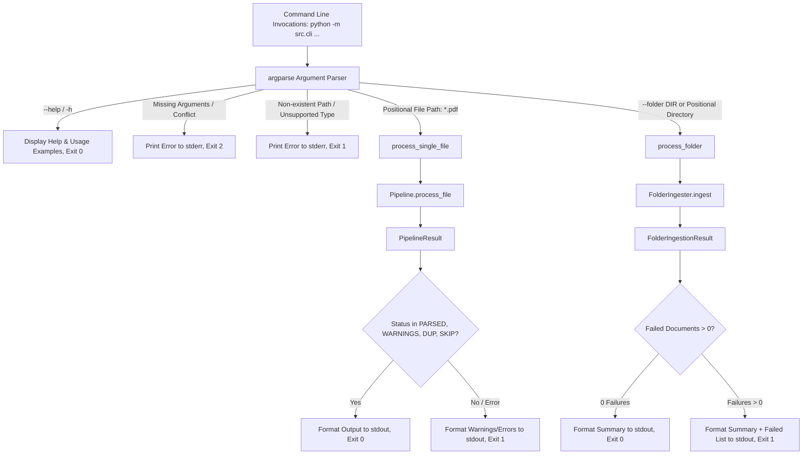

# Step 16: Command-Line Interface (CLI)

## 1. Purpose of the CLI

The Command-Line Interface (`src/cli/`) provides a clean, user-facing terminal entry point to process:
1. **Single PDF Statements**: Process an individual PMS or AIF financial statement through the full pipeline.
2. **Folder Batches**: Ingest all PDF statements from a local directory (with optional recursive scanning) using the folder ingestion subsystem.

The CLI acts purely as an orchestrator and command-line entry point. It **does not reimplement** any parsing, classification, validation, fingerprinting, storage, or duplicate detection logic, delegating completely to the existing `Pipeline` and `FolderIngester` implementations.

---

## 2. Architecture & Delegation Flow



---

## 3. Supported Commands and Arguments

The CLI can be invoked via standard Python module execution:

```bash
python -m src.cli [path] [options]
```

### Positional Arguments
- `path` *(optional)*: Path to a single PDF statement file or a directory to ingest. If a directory path is supplied positionally, the CLI automatically detects it and runs folder ingestion.

### Options
- `-f, --folder DIR`: Explicitly specify a directory path containing statement PDFs to ingest in batch.
- `-p, --password PASSWORD`: Candidate password for encrypted PDF files. The password is passed securely to the pipeline and **never printed** to stdout, stderr, or log messages.
- `-r, --recursive`: Recursively scan subdirectories for PDF files (folder mode only).
- `-v, --verbose`: Display detailed diagnostic information (document ID, classification decision, file hash, and per-document outcomes).
- `-h, --help`: Show help text with descriptions and usage examples.

---

## 4. Usage Examples

### Process an individual statement:
```bash
python -m src.cli ./samples/synthetic/format_a.pdf
```
Output:
```text
File: format_a.pdf
Status: PARSED
Statement Type: PMS
Format ID: format_a
Warnings: 0
Errors: 0
```

### Process an individual encrypted statement:
```bash
python -m src.cli ./samples/encrypted.pdf --password SecretPassword
```

### Process a folder of statements:
```bash
python -m src.cli --folder ./samples/synthetic/
```
Output:
```text
Directory: /Users/purvijain/Desktop/activvMoney/pms-parser/samples/synthetic
Discovered: 4
Processed: 4
Successful: 4
Duplicates: 0
Skipped: 0
Quarantined: 0
Failed: 0
```

### Process a folder recursively with verbose output:
```bash
python -m src.cli ./samples/ --recursive --verbose
```

---

## 5. Output and Exit-Code Policy

### Standard Streams:
- **`stdout`**: Normal processing outputs, status summaries, and batch metrics.
- **`stderr`**: Routine input errors, missing path messages, argument conflicts, and fatal pipeline exceptions.

### Exit Codes:
| Exit Code | Condition | Description |
| :---: | :--- | :--- |
| **`0`** | **Complete Success** | Single file parsed successfully (`PARSED`, `PARSED_WITH_WARNINGS`, `DUPLICATE`, or `SKIPPED`); or folder batch completed with `0` failed documents. |
| **`1`** | **Processing / Path Failure** | Input file/directory not found; unsupported file extension; single file failed parsing (`FAILED`, `NEEDS_PASSWORD`, etc.); or folder batch had one or more failed documents (`failed > 0`). |
| **`2`** | **CLI Usage / Argument Error** | No arguments supplied; both positional path and `--folder` specified; or unrecognized options. |

### Partial Folder Failures Policy:
When processing a folder containing multiple files, if any document fails extraction, parsing, or password decryption, the CLI outputs the full aggregate counts, lists the specific failed documents, and returns a **non-zero exit code (`1`)** to signal to caller scripts or automation pipelines that the batch was not 100% clean.

---

## 6. Files Created or Modified

- **Created**:
  - `src/cli/__init__.py`: Package init exporting `main`, `create_parser`, `process_single_file`, and `process_folder`.
  - `src/cli/__main__.py`: Standard executable module entry point for `python -m src.cli`.
  - `src/cli/cli.py`: Core CLI implementation with `argparse`, input verification, pipeline delegation, stream formatting, and exit code management.
  - `tests/test_cli.py`: 15 focused unit tests covering help output, argument validation, single-file processing, password forwarding, failure handling, folder batches, recursive mode, and entry point execution.
  - `docs/ai_log/step-16.md`: Documentation for Step 16 CLI implementation.

---

## 7. Known Limitations

1. **Synchronous Execution**:
   - The CLI processes files sequentially within the current process. Batch acceleration using parallel worker processes is not included in this step.
2. **Interactive Prompts**:
   - The CLI operates strictly non-interactively; interactive password prompts (e.g. `getpass`) are not required by this step since passwords can be provided via `--password` or configuration.
3. **No Direct Email Ingestion CLI Subcommand**:
   - Email ingestion remains accessible via the Python API (`src.ingestion.email`) or folder ingestion for `.eml` files; full email server sync CLI commands are scheduled for subsequent integrations.
