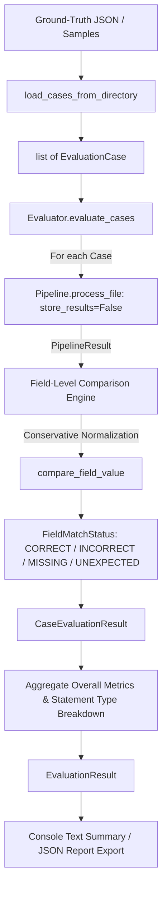

# Step 17: Parser Evaluation Framework

## 1. Purpose & Architecture

The **Parser Evaluation Framework** (`src/eval/`) provides a lightweight, reproducible, and deterministic test suite to evaluate the accuracy of the statement parser against ground-truth expectations.

It answers key questions:
- How many evaluation documents were processed successfully?
- How often did the parser extract the expected ground-truth values?
- Which fields were extracted correctly, incorrectly, or remained missing?
- What execution or validation errors occurred?
- How does performance vary between PMS and AIF statements?

The framework acts as an **independent inspection tool**, not a second parsing engine. It reuses the existing `Pipeline` interface and domain models (`Statement`, `Summary`, `Holding`, `Transaction`) and executes with `store_results=False` to ensure evaluation runs do not contaminate the production SQLite database.



---

## 2. Defining Evaluation Cases & Expected Outputs

Evaluation cases are structured using the `EvaluationCase` model:

```python
class EvaluationCase(BaseModel):
    case_id: str                          # Stable test identifier
    file_path: str                        # Path to target statement PDF
    expected_statement_type: str | None   # Expected category (e.g. PMS or AIF)
    expected_fields: dict[str, Any]       # Dictionary of ground-truth field values
    password: str | None                  # Decryption password for protected tests
    metadata: dict[str, Any]              # Test tags and origin details
```

### Loading Synthetic Datasets
Evaluation cases can be loaded directly from synthetic ground-truth pairs (`*.json` and companion `*.pdf` generated by `src.sample_generator`):

```python
from src.eval import load_cases_from_directory, load_case_from_ground_truth

# Load an entire suite of synthetic evaluation cases
cases = load_cases_from_directory("samples/synthetic")

# Or load an individual case
case = load_case_from_ground_truth("samples/synthetic/format_a1.json")
```

All data in `samples/synthetic/` is synthetic financial data generated for testing purposes.

---

## 3. Field Matching & Monetary Tolerances

The field comparison engine (`src/eval/comparator.py`) extracts values using attribute inspection and dot notation (e.g., `summary.closing_value`, `provider_name`, `holdings_count`).

### Field Match Statuses:
- **`CORRECT`**: Actual extracted value matches the expected ground truth within allowed tolerance.
- **`INCORRECT`**: Actual value was extracted but differs from the expected value.
- **`MISSING`**: Expected field value was defined in ground truth, but the parser extracted `None` or failed to extract the field.
- **`UNEXPECTED`**: Expected value was `None`, but the parser extracted a non-null value.

### Key Comparison Rules:
1. **Legitimate Zero and False Handling**:
   - Genuine `Decimal("0.00")` matches `Decimal("0.00")`.
   - Missing fields (`None`) never match legitimate zero or `False` values.
   - Two missing values (`None == None`) are never treated as a successful extraction if an expected field was defined.
2. **Monetary Decimal Tolerances**:
   - Avoids floating-point comparison. Both actual and expected values are evaluated as `Decimal`.
   - Condition: `abs(actual_decimal - expected_decimal) <= monetary_tolerance`.
   - Default tolerance: `Decimal("0.01")` (configurable via `EvaluationConfig(monetary_tolerance=Decimal("0.00"))`).
3. **Date Normalization**:
   - Dates in `date`, `datetime`, or ISO string format are conservatively normalized to `YYYY-MM-DD` strings before comparison.
4. **Enum and String Unwrapping**:
   - Enum instances (e.g., `StatementType.PMS`) are compared against their string values (`"PMS"`). Strings are trimmed of leading/trailing whitespace.

---

## 4. Metrics & Exact Denominators

| Metric | Definition | Denominator / Scope |
| :--- | :--- | :--- |
| **`total_cases`** | Total number of evaluation test cases evaluated. | Count of input cases. |
| **`processed_cases`** | Number of cases dispatched through the pipeline. | Count of input cases. |
| **`successful_cases`** | Cases where `res.status in (PARSED, PARSED_WITH_WARNINGS)`. | Count of cases. |
| **`failed_cases`** | Cases where pipeline failed or raised an exception. | Count of cases. |
| **`perfect_cases`** | Cases processed successfully with **100% field match** (`incorrect == 0 and missing == 0`). | Count of cases. |
| **`total_expected_fields`** | Sum of all expected fields defined across all cases. | Sum of `len(case.expected_fields)`. |
| **`correct_fields`** | Sum of fields matching `FieldMatchStatus.CORRECT`. | Count of fields. |
| **`incorrect_fields`** | Sum of fields matching `FieldMatchStatus.INCORRECT`. | Count of fields. |
| **`missing_fields`** | Sum of fields matching `FieldMatchStatus.MISSING`. | Count of fields. If a document fails parsing completely, all its expected fields are counted as missing. |
| **`overall_field_accuracy`** | `correct_fields / total_expected_fields` | `total_expected_fields` (returns `0.0` if denominator is 0). |
| **`by_statement_type`** | Breakdown of case counts, success counts, perfect counts, and field accuracy grouped by statement type (e.g. `PMS`, `AIF`). | Grouped per statement type. |

---

## 5. Running the Evaluator & Generating Reports

### Programmatic API

```python
from src.eval import Evaluator, EvaluationConfig, load_cases_from_directory

# 1. Load test cases
cases = load_cases_from_directory("samples/synthetic")

# 2. Run evaluation
evaluator = Evaluator(config=EvaluationConfig(monetary_tolerance=Decimal("0.01")))
result = evaluator.evaluate_cases(cases)

# 3. Print human-readable report
print(result.to_text_report())

# 4. Export machine-readable JSON report
result.write_report("eval_report.json", report_format="json")
```

### Command-Line Execution

```bash
# Evaluate synthetic dataset and display console report
python -m src.eval samples/synthetic

# Export reports to disk
python -m src.eval samples/synthetic --json-out reports/eval.json --text-out reports/eval.txt
```

---

## 6. What the Evaluation Does and Does Not Measure

### What it Measures:
- Field-level precision and extraction recall against defined ground truth.
- Accuracy of portfolio summary totals, cash balances, and client metadata.
- Rate of clean parsing vs pipeline failures across statement formats.

### What it Does NOT Measure:
- **Financial correctness of un-annotated rows**: If ground truth only verifies 5 fields, matching those 5 fields does not guarantee the rest of the document is accurate.
- **OCR Quality**: Evaluates PDF text extraction, not optical character recognition on scanned images.
- **LLM Synthesis Latency/Cost**: Evaluates deterministic parsing accuracy rather than LLM token overhead.

---

## 7. Files Created or Modified

- **Created**:
  - `src/eval/__init__.py`: Package entry point exposing evaluation models, comparator, evaluator, and loaders.
  - `src/eval/models.py`: Data models (`EvaluationCase`, `FieldComparisonResult`, `CaseEvaluationResult`, `EvaluationResult`, `EvaluationConfig`, `StatementTypeMetrics`).
  - `src/eval/comparator.py`: Conservative field extraction, Decimal tolerance comparisons, and date normalizations.
  - `src/eval/evaluator.py`: Core `Evaluator` class orchestrating pipeline runs and aggregating metrics.
  - `src/eval/loader.py`: Ground-truth JSON and directory dataset loaders.
  - `src/eval/__main__.py`: CLI tool for running evaluations from terminal (`python -m src.eval`).
  - `tests/test_evaluation.py`: 15 comprehensive unit tests covering field matching, zero/false distinction, tolerance arithmetic, pipeline crash isolation, report serialization, and dataset loaders.
  - `docs/ai_log/step-17.md`: Step 17 implementation log and metric definitions.

---

## 8. Step 17.2 — Synthetic Evaluation Setup Fix

### Root Cause

The production `specs/` directory was empty. `SpecStore.match_spec_by_fingerprint()` found no candidates and returned `UNKNOWN`. The pipeline therefore set every document status to `NEEDS_REVIEW` (the unknown-format path), leaving `PipelineResult.statement = None`. The evaluator consequently reported all 114 expected fields as `MISSING`.

### Fix

Added `src/eval/synthetic_specs.py` — a spec-fixture module that:

1. Defines `ParsingSpec` objects for every synthetic format family using locators derived directly from the format-builder source files.
2. Calls `extract_pdf()` + `extract_fingerprint()` on the actual sample PDFs to generate live fingerprints.
3. Saves the specs (with fingerprints) into a caller-supplied `SpecStore` backed by a temporary directory.
4. Is exposed as `build_synthetic_spec_store(spec_store, samples_dir)`.

`src/eval/__main__.py` was updated to create a `tempfile.TemporaryDirectory`, call `build_synthetic_spec_store`, then construct `Pipeline(spec_store=..., config=PipelineConfig(store_results=False))` and inject it into `Evaluator`. The production `specs/` directory is never read or written.

### Format-specific extraction rules

| Format | Format ID | Key differences handled |
|---|---|---|
| `format_a1`, `format_a2`, `format_a1_encrypted` | `synthetic-format-a` | Same spec; fingerprint from first available PDF |
| `format_a_messy` | `synthetic-format-a-messy` | Own spec; multi-page holdings (`multi_page=True`) |
| `format_a_drift` | `synthetic-format-a-drift` | Renamed column `"Net Value (INR)"` for `market_value`; renamed summary anchor omitted (row labels unchanged) |
| `format_b` | `synthetic-format-b` | `Account Number:`, `Report Period:`, `Base Currency:` meta anchors; `Scrip Name`/`ISIN Code` holdings columns; `Trade Ledger` / `Trade Date`/`Activity`/`Consideration (INR)` transaction columns |
| `format_c` | `synthetic-format-c` | AIF (`statement_type=AIF`); `holdings_table=None`; `Investor ID:`/`Commitment Period:` meta anchors; `Units Held`/`NAV Per Unit`/`Total Investment Value` summary anchors; `Cash Ledger` transactions |

### Design decisions

- **Isolation**: specs exist only in the temporary directory for the duration of the evaluation run. No spec file is committed to the repository.
- **Determinism**: fingerprints come from the actual PDFs, so the match score seen at evaluation time equals what the pipeline would see in production for those files.
- **Idempotency**: `save(spec, overwrite=True)` means `build_synthetic_spec_store` can be called multiple times safely (e.g., in parametrized test runs).
- **No bypass of matching**: the full fingerprint-comparison path runs unmodified. If a PDF's fingerprint scores below 0.90 relative to its registered spec, the pipeline correctly routes it to `NEEDS_REVIEW`.

### Known limitations

- **Format B horizontal summary**: the horizontal 2-row summary table in Format B is challenging for `VALUE_RIGHT_OF_ANCHOR`. The locators use `VALUE_RIGHT_OF_ANCHOR` with the label text; whether pdfplumber surfaces these as `key → value` pairs depends on how it reads the horizontal cell layout. If these fields are missing after testing, a `TABLE_AFTER_ANCHOR` locator with positional column indices (`"0"`, `"1"`, …) can be used as a follow-up fix.
- **Provider/strategy name extraction via regex**: the regex `^(.+?)\s+[—\-]{1,2}\s+.+$` matches the subtitle line. If the provider or strategy name contains an em-dash internally, it may be misparse. This is acceptable for the synthetic dataset where names are controlled.

### Files Created or Modified (Step 17.2)

- **Created**: `src/eval/synthetic_specs.py` — spec-fixture module.
- **Created**: `tests/test_eval_synthetic_specs.py` — 13 focused tests.
- **Modified**: `src/eval/__init__.py` — exports `build_synthetic_spec_store`.
- **Modified**: `src/eval/__main__.py` — injects synthetic SpecStore into the CLI evaluation pipeline.
